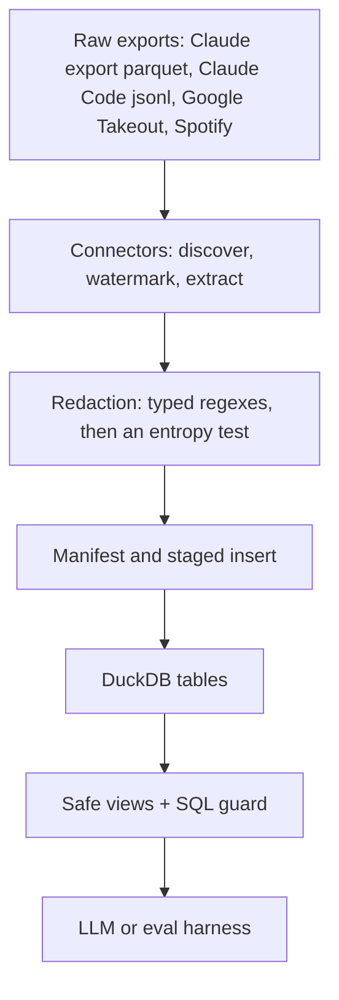

# lifelake

lifelake loads your personal data exports (Claude conversations, Claude Code transcripts, Google Takeout and Spotify) into one DuckDB file that you can query with SQL. It rests on three ideas. An incremental manifest records every input file, so a refresh only reads what changed. Redaction at ingest replaces secret-shaped strings with a marker before any text reaches a table. Read-only safe views leave out free text and coordinates, so an LLM can write SQL over the lake without reading your messages. The demo data is synthetic: it describes an invented person and is generated by hand-set distributions, not fitted to anyone's real data.

## 5-minute quickstart

Set `REPO_URL` to this repo's URL or a local path. [uv](https://docs.astral.sh/uv/) is required as written, though a plain `python3 -m venv` plus `pip` works too.

```bash
git clone "$REPO_URL" lifelake
cd lifelake
uv venv --python python3 .venv
. .venv/bin/activate
uv pip install -e '.[dev]'
make demo && pytest
```

`make demo` writes the synthetic exports to `demo_data/`, builds `demo.duckdb` from them and scans the result for secrets. Point the CLI at the demo lake:

```
export LIFELAKE_DB=demo.duckdb
```

Run a query. The output below is real output from the demo.

```
$ lifelake query "SELECT artist, count(*) AS plays FROM safe.spotify_plays GROUP BY artist ORDER BY plays DESC, artist LIMIT 5"
SQL:
SELECT artist, count(*) AS plays FROM safe.spotify_plays GROUP BY artist ORDER BY plays DESC, artist LIMIT 5

rows: 5
artist          | plays
----------------+------
Neon Mirrors    | 1786 
Paper Rivers    | 882  
Electric Meadow | 568  
Neon Engines    | 384  
Paper Harbor    | 336  
```

The demo exports contain planted fake secrets, and the redaction log counts what happened to them:

```
$ lifelake query "SELECT type, sum(hits) AS hits FROM safe.redaction_log GROUP BY type ORDER BY hits DESC, type LIMIT 5"
SQL:
SELECT type, sum(hits) AS hits FROM safe.redaction_log GROUP BY type ORDER BY hits DESC, type LIMIT 5

rows: 5
type            | hits
----------------+-----
url_credentials | 50  
password        | 35  
openai_key      | 18  
slack_token     | 17  
github_token    | 15  
```

The SQL guard refuses anything outside the safe views and exits with status 2:

```
$ lifelake query "SELECT text FROM lake.main.events LIMIT 1"
REJECTED: 'lake.main.events' is not a safe view; use safe.<view> (calendar_events, claude_ai_conversations, claude_ai_messages, claude_code_messages, email_meta, events, google_activity, location_points, manifest, redaction_log, runs, spotify_plays, tz_periods, web_visits)
```

`lifelake context` prints everything an LLM gets to see: each safe view, its row count, its columns and three sample values per column. This command shows the first line and three column lines of the full output:

```
$ lifelake context | sed -n '1p;4,6p'
# Safe views (query as safe.<view>; nothing else is readable)
- ts_utc TIMESTAMP WITH TIME ZONE | e.g. '2024-02-27 00:00:00+00:00', '2024-08-27 00:00:00+00:00', '2024-10-20 00:00:00+00:00'
- local_ts TIMESTAMP | e.g. '2024-02-26 18:00:00', '2024-08-26 19:00:00', '2024-10-19 19:00:00'
- tz VARCHAR | e.g. 'America/Chicago', 'Europe/Lisbon'
```

## Architecture



Raw files are only read. They are never copied into the lake or changed. Each `lifelake refresh` adds one row per source to the `runs` table, and `SCHEMA.md` is rewritten next to the database.

## Connectors

| Name | Input | Tables | Point it at your export |
|---|---|---|---|
| `claude_ai` | `claude_all_transcripts*.parquet` (rows with `source = 'claude.ai'`) | `claude_ai_conversations`, `claude_ai_messages` | `LIFELAKE_CLAUDE_EXPORT_DIR` |
| `claude_code` | `claude_code_transcripts*.parquet` and live `*.jsonl` transcripts | `claude_code_messages` | `LIFELAKE_CLAUDE_EXPORT_DIR`, `LIFELAKE_CLAUDE_PROJECTS` |
| `takeout` | Google Takeout folder: My Activity (JSON and HTML), Chrome history, location history, `.ics`, `.mbox` | `events` | `LIFELAKE_TAKEOUT_DIR` |
| `spotify` | Spotify account data and extended streaming history | `events` | `LIFELAKE_SPOTIFY_DIR` |

[docs/connectors.md](docs/connectors.md) gives the exact input formats, explains the Source contract and shows how to add a connector.

## Privacy model

**Redaction is a filter, not a guarantee.** It runs at ingest on text fields and uses regexes and an entropy test. Each hit becomes `[REDACTED:<type>]`, and only counts by type are stored.

It catches private key blocks, Anthropic, OpenAI, GitHub, AWS, Stripe, Google, Slack and Telegram credentials, JWTs, passwords in URLs, broker-style account IDs, values after keywords such as `password=` or `api_key:`, and long letter-and-digit tokens that look random.

It misses a lot, including:

- **PII is not removed.** Names, email addresses, phone numbers and street addresses stay in the raw tables.
- A secret with no known shape and no keyword next to it, if it is short or hexadecimal.
- A purely alphabetic password. `password=correcthorse` looks like code to the filter and stays as it is.

Rows already loaded are not redacted again when the patterns change. `lifelake scan` runs the regex set over every text column of the lake and exits 1 on any hit. It reports counts only.

**Some inputs are never read or never kept.**

- The Spotify connector reads a fixed list of file names. `Userdata.json` and `Payments.json` are never opened.
- IP addresses, user agents and usernames in the Spotify extended history are dropped.
- The Takeout and Spotify connectors skip paths that look like credential stores, such as `.ssh`, `.env*`, `*.pem` and `*cookies*.json`.

**Safe views leave out free text and coordinates.** They exclude message bodies, thinking, tool input and output, attachments, conversation names and summaries, working directories, event text, context, URLs, raw payloads and location coordinates. Lengths such as `text_chars` stand in for the text. The guard in `lifelake/query.py` accepts one SELECT or WITH statement, rejects raw tables, system tables and table functions, attaches the lake read-only, turns off external file access and stops a query after 60 seconds.

**Safe views are not anonymous.** They still expose:

- project keys, relative paths, source file names and git branches, which can contain a username
- web domains, mail sender domains, device names and client IDs
- Spotify artist and track names, on purpose
- notes in the `runs` table, which can name input files that failed to parse

`lifelake context` sends sample values from these columns to the LLM. Read its output before you use a hosted model.

**The database file stays private.** Raw tables still hold the redacted text, names, addresses and raw coordinates. Do not publish or sync the `.duckdb` file, and treat `SCHEMA.md` with care too. It holds redaction counts and your travel dates.

**Before you publish a fork,** put the terms that must not ship in a file outside the repo, one per line, and run:

```
scripts/privacy_scan.sh /path/outside/the/repo/terms.txt
```

It checks the working tree, tracked file names, every commit's content, author and committer identities and commit messages, then runs `gitleaks`, which must be installed for a full result. It prints only counts and locations, and exits 1 on any hit.

## Using your own data

| Variable | Default | Meaning |
|---|---|---|
| `LIFELAKE_DB` | `lifelake.duckdb` | Database file. `SCHEMA.md` is written next to it. |
| `LIFELAKE_CLAUDE_EXPORT_DIR` | `data/claude_export` | Folder with the Claude parquet files |
| `LIFELAKE_CLAUDE_PROJECTS` | `~/.claude/projects` | Root of the live Claude Code jsonl transcripts |
| `LIFELAKE_TAKEOUT_DIR` | `data/takeout` | Unzipped Google Takeout folder |
| `LIFELAKE_SPOTIFY_DIR` | `data/spotify` | Unzipped Spotify export folder |
| `LIFELAKE_DEFAULT_TZ` | `UTC` | IANA zone for `local_ts` outside travel periods |
| `LIFELAKE_TRAVEL` | empty | Travel periods as `Zone:YYYY-MM-DD..YYYY-MM-DD`, comma separated |
| `LIFELAKE_RECENT_SECONDS` | `1800` | Skip live jsonl files modified this recently, since they may still be growing |
| `LIFELAKE_WORKERS` | CPU count minus 2, from 1 to 16 | Worker processes for parsing and scanning |

Relative paths resolve against the current directory. `LIFELAKE_DEFAULT_TZ` and `LIFELAKE_TRAVEL` take effect only when the database is created. `CLAUDE_CODE_SESSION_ID`, when set, keeps a running Claude Code session from ingesting its own transcript.

Keep your exports outside the repo, or make sure git ignores them. Then:

```
export LIFELAKE_DB=~/lifelake/my.duckdb
export LIFELAKE_TAKEOUT_DIR=~/exports/takeout
export LIFELAKE_SPOTIFY_DIR=~/exports/spotify
lifelake refresh takeout
lifelake refresh spotify
lifelake scan
```

`lifelake refresh` with no argument runs all four connectors. A connector whose input is missing finds no files and adds no rows. Running a refresh again skips files whose size and modification time have not changed.

## Evaluating an LLM on the lake

`eval/run.py` scores a model's SQL against the gold questions in `eval/gold.jsonl`; see [eval/README.md](eval/README.md).

## Development

```
make test
make lint
```

`make demo` rebuilds the demo lake and `make clean` removes it. CI runs the quickstart commands, `ruff check .` and `gitleaks` over both the history and the checked-out files.

## License

MIT. Copyright (c) 2026 The lifelake authors. See [LICENSE](LICENSE).

## TODO

- Add a converter from the JSON files in a claude.ai data export to the parquet shape the `claude_ai` connector reads. Today that connector reads parquet only.
- Add PII detection. Redaction only targets secrets.
- Re-redact rows that are already loaded when the patterns change. `lifelake scan` reports leftovers but does not fix them.
- Remove rows when an input is deleted or edited. Loading only inserts new keys, so old rows stay.
- Recompute `local_ts` when the time zone settings change. Today `tz_periods` is fixed when the database is created.
- Support Windows. The `claude_code` connector and `lifelake scan` use the `forkserver` start method, which Windows does not have.
- Test more platforms. CI covers Linux and Python 3.12 only, while `pyproject.toml` allows Python 3.11.
- Parse more of the Takeout: products beyond the formats listed above are ignored without a message, and for multipart mail only the first `text/plain` part is kept.
- Add safe views for Spotify searches and playlists. Today they appear only as rows in `safe.events`, without text.
- Cap query memory in the guard. It only has a time limit.
- Write a harder gold set. The current 30 questions are simple aggregates, and a first model run scored 30/30.
